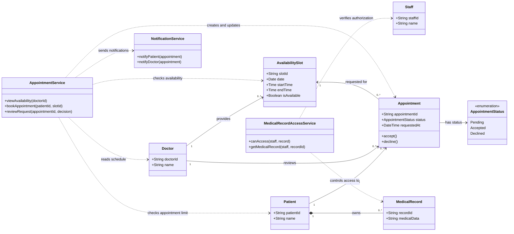

# Clinic Appointment Booking System — Class Diagram

The diagram models the patients, doctors, appointment requests, and availability slots used by the documented use cases. It also shows the services responsible for booking rules, notifications, and protecting medical data.

## Rules and requirement mapping

- **R1, R2, R3:** `AppointmentService` displays availability, creates pending requests, and processes a doctor's accept or decline decision.
- **R4:** A patient may have at most **7 upcoming appointments**. `AppointmentService` enforces this before creating a request.
- **R5:** Medical-record access goes through `MedicalRecordAccessService`; only authorized staff may access a `MedicalRecord`.
- **R6:** Availability returned by `viewAvailability` must be displayed within **2 seconds**.
- **R7:** The application screens for these interactions must be usable on mobile phone screens.
- An appointment has one patient, one doctor, and one requested time slot. Its status is `Pending`, `Accepted`, or `Declined`.
- A slot must be available to create a booking request. Accepting a request makes the slot unavailable; declining it leaves the slot available.
