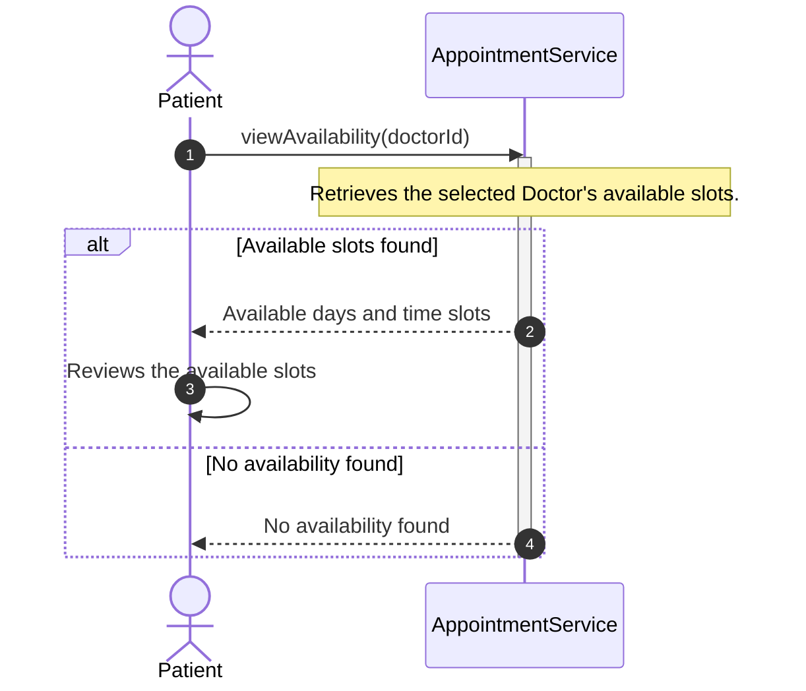
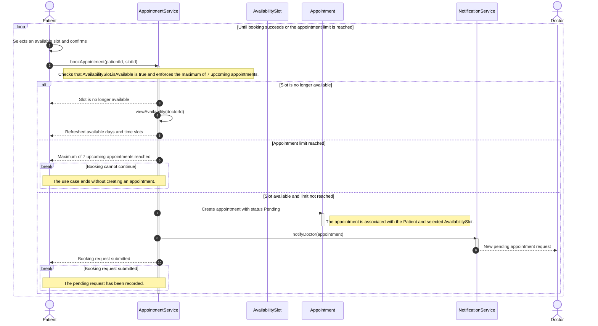
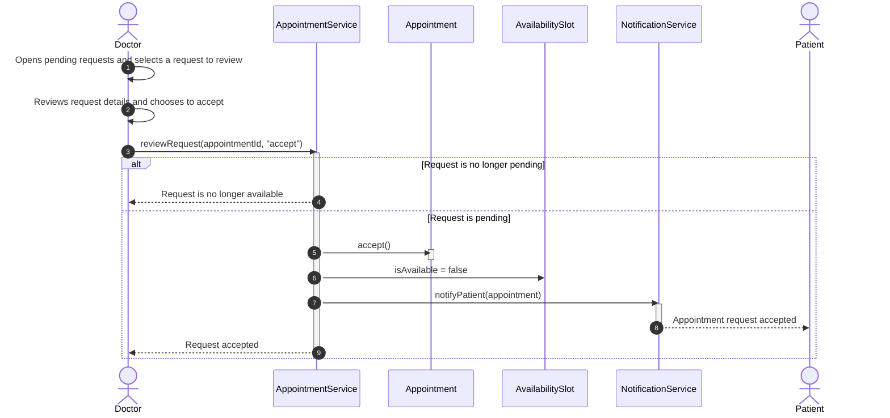
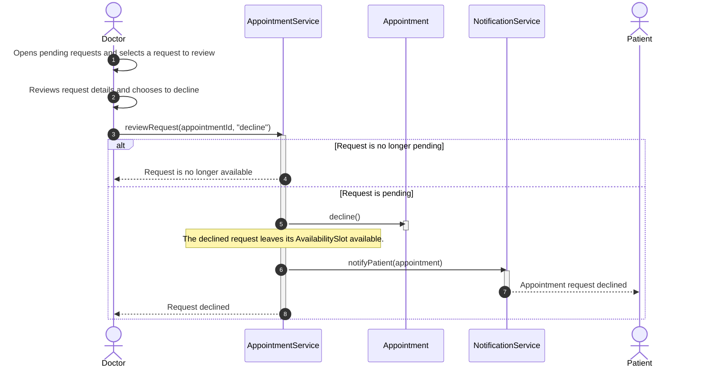

# System Sequence Diagrams

## 1. View Doctor Availability
- **Description:** The Patient requests and reviews a Doctor's available days and time slots.

## 2. Book an Appointment
- **Description:** The Patient submits a booking request for an available slot, subject to availability and the seven-upcoming-appointments limit.

## 3. Accept Appointment Request
- **Description:** The Doctor accepts a pending appointment request, making its time slot unavailable and notifying the Patient.

## 4. Decline Appointment Request
- **Description:** The Doctor declines a pending appointment request, leaves its time slot available, and notifies the Patient.

